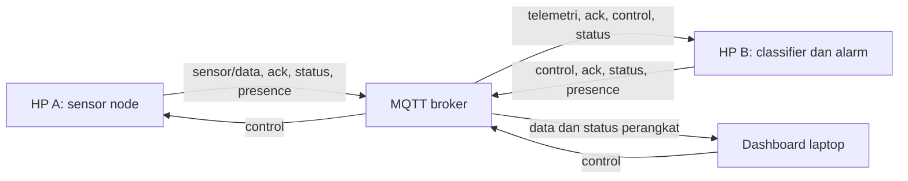

# SmartPark: Vehicle Movement & Anti-Theft Alert System

Sistem monitoring pergerakan kendaraan dan peringatan dini potensi pencurian berbasis Internet of Things. SmartPark menggunakan dua perangkat Android, sensor accelerometer dan gyroscope, komunikasi MQTT melalui TLS, serta dashboard web pada laptop.

Proyek ini merupakan prototipe akademik. Sistem mengidentifikasi pola pergerakan berdasarkan aturan yang dapat dijelaskan. Klasifikasi risiko menunjukkan kondisi yang perlu diperiksa dan tidak membuktikan terjadinya pencurian.

## Fitur

- Akuisisi dua sensor fisik melalui Termux:API.
- Adapter streaming yang mempertahankan satu proses sensor dan menggunakan frame terbaru.
- Pengolahan RMS percepatan dan akumulasi rotasi per window.
- Klasifikasi menggunakan rule-based sensor fusion, window berturut-turut, dan cooldown.
- Kontrol ARM, DISARM, dan PING dengan ACK serta pengukuran round-trip time.
- Heartbeat perangkat, Last Will MQTT, reconnect, dan status Online, Stale, serta Offline.
- Dashboard dengan grafik, klasifikasi, riwayat peringatan, dan ekspor CSV.
- Penandaan sumber simulasi dan sensor fisik secara eksplisit.

## Arsitektur sistem

| Komponen | Peran | Teknologi |
| --- | --- | --- |
| HP A | Membaca sensor, menghitung metrik, menerima kontrol, dan mengirim ACK | Android, Termux, Termux:API, Python |
| HP B | Menerima telemetri, menjalankan klasifikasi, mengatur alarm, dan mengirim kontrol | Android, Termux, Termux:API, Python |
| Broker | Meneruskan pesan antarperangkat | MQTT melalui TLS dan Secure WebSocket |
| Laptop | Menampilkan data dan mengirim kontrol | HTML, CSS, JavaScript, MQTT.js |



HP A menjadi sumber status monitoring. HP B menerapkan status ARM berdasarkan ACK HP A. Proses deteksi utama berjalan pada HP B, sedangkan dashboard menampilkan metrik sensor dan hasil klasifikasi.

Komunikasi kontrol HP B ke HP A berbeda dari telemetri sensor. Kontrol mengatur monitoring; nilai RMS dan rotasi diterbitkan oleh HP A setelah monitoring aktif.

## Struktur proyek

```text
SmartPark/
|-- dashboard/
|   |-- index.html
|   |-- style.css
|   |-- dashboard.js
|   `-- dashboard-model.js
|-- smartpark/
|   |-- edge_a.py
|   |-- edge_b.py
|   |-- sensor.py
|   |-- sensor_stream.py
|   |-- processing.py
|   |-- classifier.py
|   |-- alarm.py
|   |-- mqttlink.py
|   |-- protocol.py
|   |-- config.py
|   |-- profile_sensor.py
|   |-- check_install.py
|   |-- build_manifest.json
|   `-- __init__.py
|-- tests/
|-- .env.example
|-- .gitignore
|-- requirements.txt
|-- run_hp_a_stream.sh
`-- README.md
```

| Berkas | Tanggung jawab |
| --- | --- |
| `edge_a.py` | Lifecycle monitoring, pengumpulan window, metrik sensor, kontrol, dan ACK HP A |
| `edge_b.py` | Sinkronisasi state, penerimaan telemetri, cooldown, worker alarm, dan menu HP B |
| `sensor.py` dan `sensor_stream.py` | Adapter pembacaan sekali jalan dan streaming Termux |
| `processing.py` | Perhitungan RMS dan integral magnitudo gyroscope |
| `classifier.py` | Keputusan berdasarkan threshold dan window berturut-turut |
| `mqttlink.py` dan `protocol.py` | Transport TLS, heartbeat, validasi payload, dan pengurutan state |
| `config.py` | Pengaturan melalui environment variable |
| `profile_sensor.py` | Pengukuran durasi pembacaan sensor tanpa MQTT |
| `check_install.py` | Pemeriksaan kesesuaian berkas package dengan manifest rilis |
| `dashboard-model.js` | Parsing pesan, status perangkat, ACK, dan riwayat yang dapat diuji |

## Persyaratan

- Dua HP Android. HP A harus memiliki accelerometer dan gyroscope.
- Laptop dengan Python dan browser yang mendukung JavaScript, Canvas, dan Secure WebSocket.
- Python 3.10 atau lebih baru dan Paho MQTT versi 2.x sesuai `requirements.txt`.
- Aplikasi Termux dan Termux:API yang kompatibel pada Android.
- Paket command-line `termux-api` untuk mengakses sensor dan getaran.
- Koneksi internet yang dapat menjangkau broker MQTT dan CDN MQTT.js.
- Node.js untuk menjalankan pengujian JavaScript.

## Instalasi dan konfigurasi

Jalankan perintah dari root proyek, yaitu folder yang memuat `requirements.txt`, `smartpark/`, dan `dashboard/`. Contoh lokasi Windows adalah `C:\SmartPark`; contoh lokasi Android adalah `~/downloads/SmartPark`.

### Windows

```powershell
cd C:\SmartPark
py -m venv .venv
.\.venv\Scripts\python.exe -m pip install -r requirements.txt
```

Jika `py` tidak tersedia, gunakan interpreter Python yang terpasang untuk membuat virtual environment. Penggunaan path interpreter seperti contoh di atas tidak memerlukan aktivasi virtual environment.

### Android

Pasang aplikasi Termux dan Termux:API, kemudian jalankan pada kedua HP:

```sh
pkg install python termux-api
cd ~/downloads/SmartPark
python -m pip install -r requirements.txt
```

Sesuaikan direktori jika proyek disimpan di lokasi lain. Aplikasi Android Termux:API dan paket command-line `termux-api` sama-sama diperlukan.

Periksa nama sensor pada HP A:

```sh
termux-sensor -l
```

Uji keluaran getaran pada HP B:

```sh
termux-vibrate -d 700
```

Pastikan getaran benar-benar terasa. Keberhasilan proses command-line perlu dibedakan dari pengamatan keluaran fisik.

### Project ID dan environment variable

Project ID harus sama pada HP A, HP B, dan dashboard. Default kode adalah `smartpark_demo_2026`. Gunakan ID unik ketika beberapa instalasi menggunakan broker yang sama.

Contoh Android:

```sh
export SMARTPARK_PROJECT="smartpark_demo_2026"
```

Contoh PowerShell:

```powershell
$env:SMARTPARK_PROJECT="smartpark_demo_2026"
```

Project ID terdiri dari 8 sampai 48 karakter berupa huruf, angka, underscore, atau tanda hubung. ID berfungsi sebagai namespace dan tidak memberikan autentikasi atau pembatasan akses.

`.env.example` merupakan referensi konfigurasi. Aplikasi tidak memuat `.env` secara otomatis. Tetapkan environment variable sebelum menjalankan program.

| Environment variable | Default | Keterangan |
| --- | --- | --- |
| `SMARTPARK_PROJECT` | `smartpark_demo_2026` | Namespace topik MQTT |
| `SMARTPARK_HOST` | `broker.hivemq.com` | Host broker untuk client Python |
| `SMARTPARK_PORT` | `8883` | Port MQTT TLS untuk client Python |
| `SMARTPARK_RMS_THRESHOLD` | `0.7` | Ambang RMS dalam m/s^2 |
| `SMARTPARK_ROT_THRESHOLD` | `0.25` | Ambang rotasi dalam rad |
| `SMARTPARK_INTERVAL` | `2` | Target durasi akuisisi window dalam detik |
| `SMARTPARK_MIN_WINDOWS` | `2` | Minimum window berurutan sebelum memenuhi syarat alarm |
| `SMARTPARK_COOLDOWN` | `6` | Jeda minimum antaralarm dalam detik |
| `SMARTPARK_MAX_SAMPLE_GAP` | `3` | Batas jeda antar-sampel untuk integral |

Endpoint browser ditetapkan pada konstanta `BROKER` di `dashboard/dashboard.js`. Perubahan broker harus diterapkan secara konsisten pada client Python dan dashboard.

## Menjalankan sistem

### 1. Jalankan HP B

Dari root proyek pada HP B:

```sh
python -m smartpark.edge_b --alarm termux
```

Tunggu `MQTT CONNECTED` dan biarkan program tetap berjalan.

### 2. Jalankan HP A dengan streaming

Shortcut berikut menggunakan nama sensor Samsung yang telah dipakai pada pengujian proyek:

```sh
bash run_hp_a_stream.sh
```

Untuk menentukan nama sensor dan parameter secara langsung:

```sh
python -m smartpark.edge_a --mode termux --acc-name "LSM6DSVTR Accelerometer" --gyro-name "LSM6DSVTR Gyroscope" --sensor-read-mode stream --sensor-delay-ms 100
```

Sesuaikan nama sensor dengan hasil `termux-sensor -l`. Jalankan satu instance node sensor pada HP A.

Mode `stream` mempertahankan satu proses sensor untuk kedua sensor. Reader latar belakang menggunakan frame terbaru yang belum dikonsumsi. Mode `sequential` dan `combined` tetap tersedia, tetapi memulai proses pembacaan kembali pada setiap sampel. Default CLI umum masih `sequential`, sehingga flag `stream` atau shortcut diperlukan untuk mengaktifkan streaming.

### 3. Jalankan dashboard laptop

```powershell
cd C:\SmartPark
.\.venv\Scripts\python.exe -m http.server 8000 --bind 127.0.0.1 -d dashboard
```

Buka [http://localhost:8000](http://localhost:8000), masukkan Project ID yang sama, kemudian pilih **Hubungkan MQTT**. Dashboard dapat berjalan tanpa proses node Python pada laptop.

Bind `127.0.0.1` membatasi server HTTP ke laptop tersebut. Akses melalui jaringan lain memerlukan konfigurasi hosting dan pengamanan tersendiri.

### 4. Aktifkan monitoring

| Menu HP B | Perintah | Perilaku |
| --- | --- | --- |
| `1` | `ARM` | Meminta HP A mengaktifkan monitoring; HP B mengikuti ACK HP A |
| `2` | `DISARM` | Meminta penghentian monitoring dan mereset deteksi |
| `3` | `PING` | Memeriksa komunikasi dan status tanpa mengubah ARM |
| `4` | Keluar | Mengirim DISARM dan mengakhiri program receiver |

Kontrol pada dashboard menggunakan topik yang sama. Tunggu ACK yang sesuai dengan perintah; status terkirim tidak menjamin perintah sudah diterapkan.

Perangkat dapat tetap Online ketika DISARM. Telemetri baru diterbitkan setelah ARM aktif dan satu window selesai diproses. Restart HP A mengembalikan monitoring ke DISARM.

### 5. Verifikasi instalasi dan timing

Paket rilis menyediakan pemeriksaan berkas:

```sh
python -m smartpark.check_install
```

Pemeriksa membandingkan SHA-256 berkas package dengan `build_manifest.json`. Perubahan kode lokal akan terdeteksi sebagai perbedaan. Manifest membantu menemukan instalasi parsial atau versi campur; manifest tidak mengautentikasi pembuat paket.

Profiling tanpa MQTT:

```sh
python -m smartpark.profile_sensor --acc-name "LSM6DSVTR Accelerometer" --gyro-name "LSM6DSVTR Gyroscope" --read-mode stream --samples 10
```

Hentikan program HP A sebelum menjalankan profiling atau `termux-sensor -c`, karena proses tersebut memakai service sensor Termux yang sama.

## Pengolahan data dan klasifikasi

### RMS percepatan

Magnitudo percepatan dibandingkan dengan referensi gravitasi 9.81 m/s^2, kemudian dihitung RMS-nya:

```text
magnitude_i = sqrt(ax_i^2 + ay_i^2 + az_i^2)
error_i = magnitude_i - 9.81
motion_rms = sqrt(mean(error_i^2))
```

RMS menggambarkan intensitas perubahan percepatan dalam satu window. Nilainya merupakan hasil pengolahan dan berbeda dari pembacaan mentah setiap sumbu.

### Akumulasi rotasi

Gyroscope diasumsikan menghasilkan kecepatan sudut dalam rad/s. Kode mengintegralkan magnitudonya dengan nilai pada ujung kanan setiap interval:

```text
omega_i = sqrt(gx_i^2 + gy_i^2 + gz_i^2)
rotation_rad = sum(omega_i * (t_i - t_(i-1)))
```

Rotasi merupakan total lintasan sudut per window. Gerakan bolak-balik tetap dapat menambah nilainya.

Timestamp stream berasal dari saat frame lengkap diterima Python melalui stdout. Adapter belum memuat timestamp event sensor Android. Startup sebelum sampel pertama tidak dimasukkan ke integral. Lima sampel dengan target akuisisi dua detik biasanya mencakup rentang timestamp sekitar 1.6 detik apabila jadwal pembacaan terpenuhi.

Durasi aktual window dan jeda antar-sampel dicatat. Window dengan jeda melebihi `SMARTPARK_MAX_SAMPLE_GAP` ditolak agar satu nilai gyro tidak diintegralkan sepanjang jeda pengamatan yang besar. Sistem melaporkan `SENSOR_ERROR` dan tidak mengganti data fisik dengan nilai buatan.

### Rule-based sensor fusion

| Kondisi default per window | Klasifikasi |
| --- | --- |
| RMS < 0.7 dan rotasi < 0.25 | `NORMAL` |
| RMS >= 0.7 dan rotasi < 0.25 | `VIBRATION_DETECTED` |
| RMS < 0.7 dan rotasi >= 0.25 | `ORIENTATION_CHANGE` |
| RMS >= 0.7 dan rotasi >= 0.25 | `HIGH_RISK_MOVEMENT` |

Kriteria alarm terpenuhi setelah sedikitnya dua window berturut-turut melewati salah satu ambang. Window normal mereset hitungan. Ketidakkonsistenan urutan telemetri, error sensor, dan sinkronisasi ulang juga mereset deteksi. Cooldown default antaralarm adalah enam detik.

Threshold merupakan nilai eksperimen. Kalibrasi perlu mempertimbangkan model HP, pemasangan, bias sensor, durasi window, serta skenario gerakan. Algoritme menggunakan aturan yang dapat dijelaskan dan tidak memerlukan model AI terlatih.

## Komunikasi MQTT

| Client | Endpoint default |
| --- | --- |
| Python pada HP A dan HP B | `broker.hivemq.com:8883` melalui TLS |
| Dashboard browser | `wss://broker.hivemq.com:8884/mqtt` |

Prefix seluruh topik adalah `smartpark/{PROJECT_ID}`:

| Suffix | Pengirim | Fungsi |
| --- | --- | --- |
| `sensor/data` | HP A | Metrik gerakan dan informasi window |
| `control` | HP B atau dashboard | ARM, DISARM, dan PING |
| `ack` | HP A dan HP B | Balasan kontrol dan informasi sinkronisasi |
| `status` | HP A dan HP B | Monitoring, error, klasifikasi, serta hasil alarm |
| `presence/HP_A` | Client MQTT HP A | Heartbeat dan koneksi HP A |
| `presence/HP_B` | Client MQTT HP B | Heartbeat dan koneksi HP B |

Pesan menggunakan QoS 1. Hanya presence yang diterbitkan sebagai retained message. Kontrol dan telemetri retained diabaikan. Client memakai ID unik, melakukan reconnect, dan memasang ulang subscription.

Field utama telemetri meliputi `device`, `session`, `sequence`, `timestamp`, `simulated`, `monitoring`, `state_revision`, `motion_rms`, `rotation_rad`, `sample_count`, `window_seconds`, dan `max_sample_gap`.

Sinkronisasi menggunakan `request_id`, session HP A, dan revisi state. Payload lama dapat dikenali sebagai aktivitas, tetapi tidak otomatis memenuhi konfirmasi sinkronisasi protokol terbaru. Paket lama, duplikat, dan state yang mendahului revisi terbaru tidak dipakai untuk mengembalikan status monitoring.

Presence dikirim saat tersambung dan setiap tiga detik. Status perangkat juga diterbitkan secara berkala. Dashboard menandai aktivitas sebagai Stale setelah lebih dari 15 detik dan Offline setelah lebih dari 45 detik tanpa bukti terbaru. Last Will atau pesan Offline dapat memperbarui status lebih awal. Jam perangkat harus sesuai karena validasi memeriksa usia pesan.

## Dashboard

Dashboard menyediakan metrik terbaru, grafik maksimum 60 sampel, aktivitas perangkat, status ARM, klasifikasi HP B, balasan setiap perangkat, waktu respons, serta ekspor CSV.

Riwayat dibatasi maksimum 100 event dan disimpan di memori tab. Refresh halaman dan koneksi manual baru menghapus riwayat; ekspor CSV bila diperlukan. Reconnect otomatis mempertahankan riwayat sesi.

`alert=true` menyatakan event aturan gerakan atau permintaan alarm. Field `alarm_result` membedakan `queued`, `simulated`, `command_completed`, `failed`, `cancelled`, dan `busy`. Nilai `command_completed` menunjukkan proses Termux selesai dengan sukses; keluaran getaran fisik tetap memerlukan pengamatan pada HP B.

## Simulasi

Simulasi antarnode tetap memakai broker. Jalankan setiap node pada terminal terpisah dengan Project ID yang sama.

Receiver simulasi pada Windows:

```powershell
.\.venv\Scripts\python.exe -m smartpark.edge_b --alarm simulated
```

Sensor simulasi pada Windows:

```powershell
.\.venv\Scripts\python.exe -m smartpark.edge_a --mode simulated --scenario high
```

Skenario tersedia: `normal`, `minor`, `suspicious`, dan `high`. Data simulasi ditandai pada payload dan dashboard. Alarm simulasi hanya menghasilkan log.

Fixture browser tanpa broker:

```powershell
.\.venv\Scripts\python.exe tests/browser_fixture.py
```

Buka `http://127.0.0.1:8001`. Halaman fixture diberi penanda pengujian lokal dan memakai data sintetik serta transport mocked. Hasil fixture tidak membuktikan kinerja sensor atau jaringan Android.

## Pengujian dan status verifikasi

Jalankan dari root proyek:

```powershell
.\.venv\Scripts\python.exe -m unittest discover -s tests -v
node --check dashboard/dashboard.js
node --check dashboard/dashboard-model.js
node --test tests/dashboard.test.cjs
```

Pada Termux, gunakan `python -m unittest discover -s tests -v` untuk tes Python.

Hasil pengujian pengembangan yang tercatat pada 30 Oktober 2026 adalah **65 tes Python lulus** dan **42 tes JavaScript lulus**. Cakupannya mencakup matematika sensor, batas klasifikasi, kontrol dan ACK, cooldown, stale telemetry, parsing stream, lifecycle subprocess, instalasi, dan state dashboard.

| Aspek | Status verifikasi |
| --- | --- |
| Unit test dan flow transport mocked | Lulus pada pengujian otomatis yang tercatat |
| MQTT TLS dan pertukaran ACK dari laptop | Diuji dengan Project ID pengujian terpisah |
| Parsing dan state dashboard | Diuji otomatis serta melalui fixture browser |
| Aliran data sensor Android sampai dashboard | Dikonfirmasi dalam pengujian pengguna |
| Getaran otomatis HP B dari pergerakan fisik HP A | Belum didokumentasikan sebagai hasil verifikasi akhir |
| False alarm, akurasi klasifikasi, dan operasi jangka panjang | Memerlukan eksperimen terkontrol lebih lanjut |

Pisahkan hasil simulasi, pengujian lokal, dan pengamatan hardware dalam laporan serta video demonstrasi. Prosedur fisik tersedia pada [VERIFIKASI_ANDROID.md](VERIFIKASI_ANDROID.md).

## Pemecahan masalah

| Gejala | Pemeriksaan dan tindakan |
| --- | --- |
| `No module named smartpark` | Masuk ke root proyek sebelum menjalankan `python -m ...` |
| `No module named smartpark.check_install` | Periksa apakah package lengkap sudah berada di folder yang dipakai Python |
| Manifest gagal | Cocokkan hasil ekstraksi dan versi berkas; perubahan kode lokal juga mengubah hash |
| Project ID tidak valid | Gunakan 8 sampai 48 karakter yang diizinkan tanpa spasi |
| Online tetapi grafik kosong | Periksa ACK ARM dan log HP A; telemetri tidak diterbitkan saat DISARM |
| Setiap read membutuhkan beberapa detik | Pastikan log menyebut `mode=stream` dan adapter streaming aktif |
| `SENSOR_ERROR` karena gap besar | Periksa durasi read, usia frame, serta timing aktual; jalankan profiling terpisah |
| Sensor hilang atau output tidak lengkap | Cocokkan nama persis dari `termux-sensor -l` dan periksa Termux:API |
| Stream berhenti atau timeout | Hentikan sensor, jalankan `termux-sensor -c`, lalu mulai kembali |
| ACK sebagian atau timeout | Periksa perangkat yang belum membalas, Project ID, koneksi, versi package, dan jam perangkat |
| Format payload lama | Perbarui package secara lengkap dan restart proses Python |
| Getaran tidak terasa | Uji `termux-vibrate -d 700` dan periksa log HP B |
| Port 8000 sudah digunakan | Gunakan server yang sudah aktif atau tentukan port lain |
| MQTT.js gagal dimuat | Periksa akses internet, CDN, dan console browser |

## Keamanan dan publikasi

Broker default bersifat publik dan tidak menggunakan autentikasi client. Pihak lain yang mengetahui atau menemukan topik dapat membaca telemetri, mengirim kontrol, atau memalsukan status. TLS melindungi koneksi transport; konfigurasi ini belum menyediakan otorisasi pengirim untuk setiap topik.

Gunakan Project ID unik untuk mengurangi pencampuran instalasi. ID unik tidak menggantikan autentikasi atau ACL broker. Jangan mengirim data pribadi, kredensial, atau lokasi melalui broker publik.

Penggunaan di luar demonstrasi memerlukan broker privat, autentikasi, ACL per perangkat, dan endpoint yang konsisten. Implementasi saat ini belum menyediakan parameter kredensial broker pada konfigurasi aplikasi.

Sebelum publikasi:

1. Tinjau berkas yang akan di-commit, termasuk berkas tersembunyi.
2. Simpan konfigurasi privat pada environment lokal; publikasikan hanya contoh tanpa rahasia.
3. Kecualikan virtual environment, cache, private key, log, dan rekaman MQTT live yang belum disanitasi.
4. Gunakan data sintetik atau hasil eksperimen yang telah ditinjau untuk contoh publik.
5. Periksa riwayat Git jika berkas sensitif pernah di-commit. `.gitignore` tidak menghapus riwayat sebelumnya.

`.gitignore` berlaku pada alur Git. Pengunggahan ZIP atau penyeretan seluruh isi folder melalui antarmuka web tetap memerlukan seleksi berkas secara manual.

## Pengembangan

Perubahan topik atau payload harus diterapkan pada HP A, HP B, dashboard, dan tes terkait. Pertahankan penandaan sumber simulasi, validasi urutan dan waktu, serta pencocokan kontrol dengan ACK.

Untuk evaluasi algoritme, catat model perangkat, pemasangan, mode akuisisi, threshold, durasi window, kondisi fisik yang dilakukan, dan hasil pengamatan. Uji keadaan diam, getaran singkat, perubahan orientasi, serta gerakan berkelanjutan secara berulang. Gunakan rangkaian pengujian terpisah untuk mengevaluasi threshold yang dipilih.
